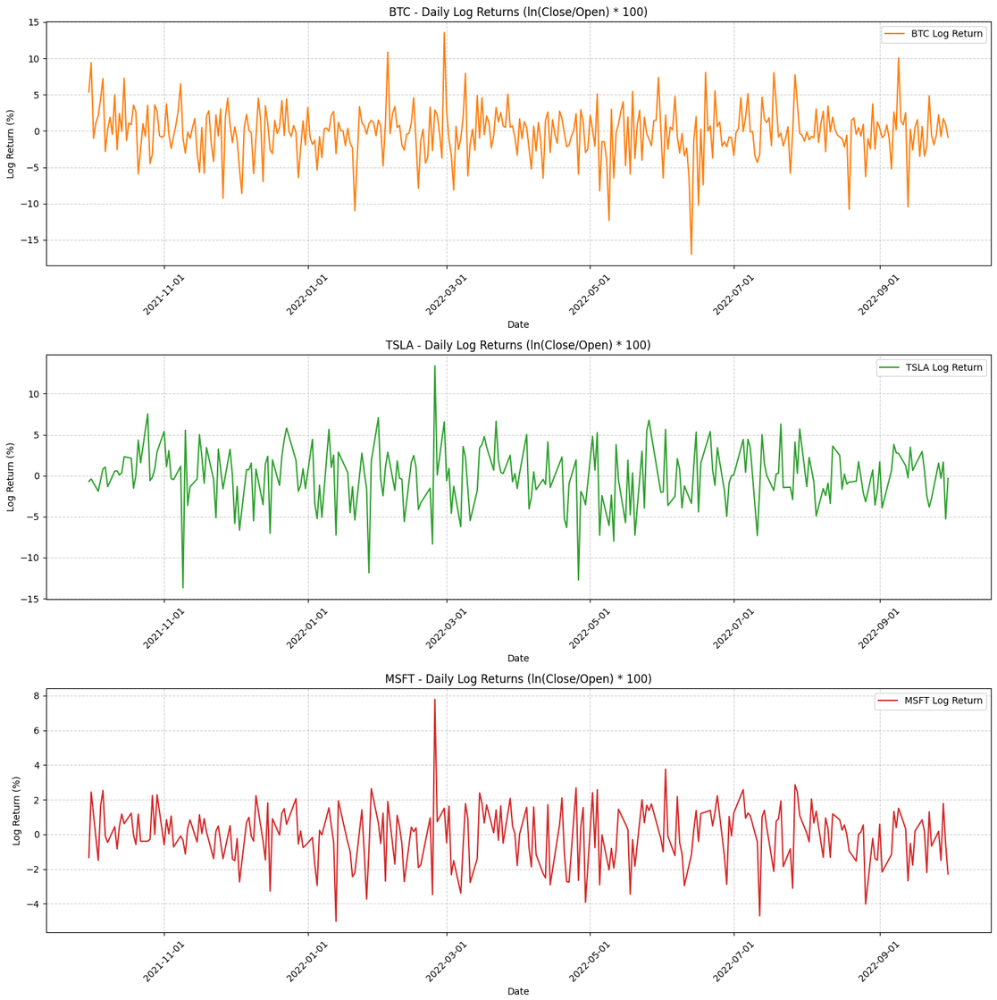
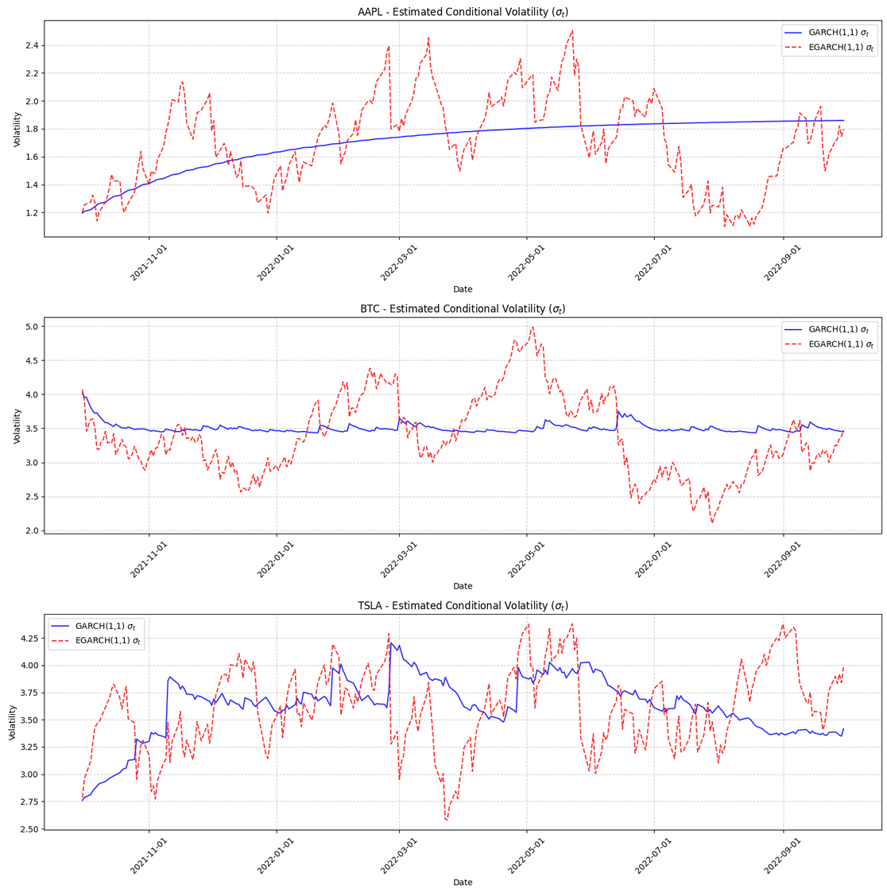
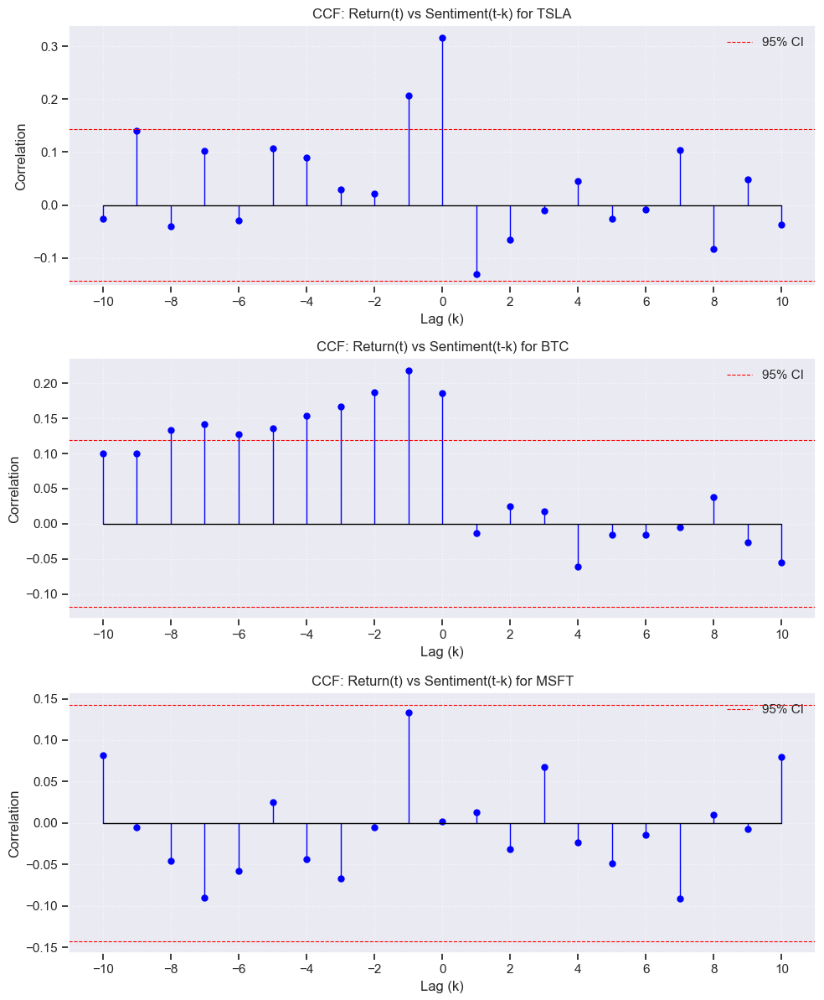
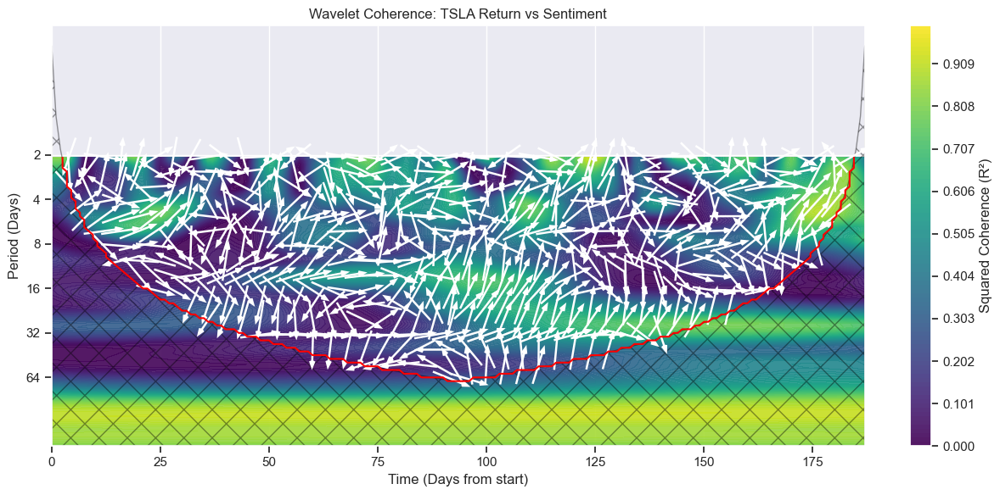
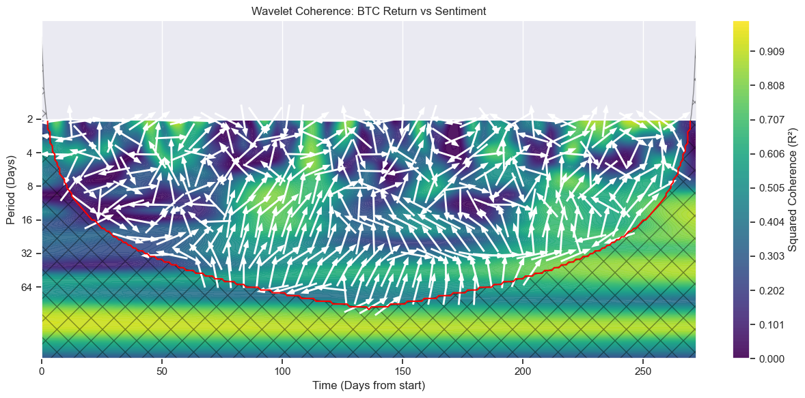

# Analysis of Investment Decisions Using Sentiment Analysis

*Analýza investičného rozhodovania s využitím sentimentálnej analýzy*

Bachelor's thesis, Prague University of Economics and Business (VŠE), Faculty of Business Administration, 2025
Author: **Tomáš Kováč** · Supervisor: doc. Mgr. et Mgr. Ing. Štěpán Bahník, Ph.D.

This repository holds the code behind the practical part of the thesis. The thesis asks whether sentiment on Twitter (X) is related to the returns and volatility of five large US stocks (**Apple, Microsoft, Tesla, Amazon, Alphabet**) and of **Bitcoin**, and whether that relationship differs between stocks and crypto.

---

## Research questions and hypotheses

1. How strongly does Twitter sentiment correlate with daily stock returns?
2. How strongly does Twitter sentiment correlate with daily cryptocurrency returns?
3. How does the sentiment–price relationship differ between stocks and cryptocurrencies?

- **H₀:** Sentiment and prices are uncorrelated, or the relationship is not statistically significant.
- **H₁:** There is a statistically significant correlation between sentiment and price, and it differs across assets.

---

## Data

| Source | Content | Period |
|---|---|---|
| [Stock Tweets for Sentiment Analysis and Prediction](https://www.kaggle.com/datasets/equinxx/stock-tweets-for-sentiment-analysis-and-prediction) (Yukhymenko, 2023) | Tweets about the 25 most-watched Yahoo Finance tickers | 30 Sep 2021 – 30 Sep 2022 |
| [Bitcoin Tweets 2021–2022](https://www.kaggle.com/datasets/hiraddolatzadeh/bitcoin-tweets-2021-2022) (Dolatzadeh, 2023) | English tweets mentioning Bitcoin | 1 Jan 2021 – 30 Jun 2022 |
| [Investing.com – Historical Data](https://www.investing.com/) | Daily OHLC and volume for AAPL, MSFT, TSLA, GOOG, AMZN and BTC/USD | matching the tweet periods |

The datasets are **not included** in the repository because of their size and licences. Download them from the links above.

### Why not live data from X or Bluesky?

The original plan was to collect posts about the top 5 stocks and top 5 cryptocurrencies (excluding stablecoins) for 2023–2024:

- **X API:** paid and heavily rate-limited. A scraper was tried as well, but the account was blocked for bot-like behaviour after about 300 requests.
- **Bluesky API** (`BLUESKY_*.py`): free, but most posts were rejected as `outside_month_range` and only about 10 relevant posts per month got through. That sample was too small and too noisy to use.

The Bluesky collector stays in the repo to document this attempt. The analysis uses the Kaggle datasets above.

---

## Repository structure

| File | Purpose |
|---|---|
| `BLUESKY_config.py` | Search terms (tickers, products, executives) for 5 stocks and 5 cryptocurrencies, plus collector settings |
| `BLUESKY_fetch_by_time.py` | Month-by-month Bluesky post collector built on `atproto` (attempt that was dropped) |
| `00_cleaning.py` | Cleans the Bitcoin tweets: merges the 2021 and 2022 files, removes users with ≥ 1000 tweets, strips mentions, URLs and non-letter characters, lowercases, deduplicates, then splits into chunks |
| `01_merging.py` | Merges the cleaned chunks back into one `bitcoin_merged.csv` |
| `03_vader.py` | Scores each tweet with VADER (`neg`, `neu`, `pos`, `compound`) for 1 Jan 2021 – 30 Sep 2022 |
| `finance.ipynb` | Intraday log returns plus GARCH(1,1) and EGARCH(1,1) volatility models with Ljung–Box diagnostics |
| `sentiment.ipynb` | Daily mean sentiment per ticker, sentiment categories, time-series plots and ADF stationarity test |
| `correlation.ipynb` | Lagged Pearson correlation, cross-correlation function (CCF) and Morlet wavelet coherence |
| `figures/` | Selected plots exported from the notebooks for this README |

### Pipeline

```
Kaggle tweets ──► 00_cleaning.py ──► 01_merging.py ──► 03_vader.py ──► sentiment.ipynb ─┐
                                                                                         ├──► correlation.ipynb
Investing.com prices ────────────────────────────────► finance.ipynb ───────────────────┘
```

---

## Methods

- **Sentiment:** the VADER lexicon (about 7,500 weighted terms plus rules for capitals, punctuation, emoji and intensifiers). The daily score *Sₜ* is the mean `compound` score per ticker. Days are labelled negative (*Sₜ* < −0.25), neutral, or positive (*Sₜ* > 0.25).
- **Returns:** intraday log returns *rₜ* = ln(Close / Open).
- **Volatility:** GARCH(1,1) for persistence (α + β) and long-run variance, and EGARCH(1,1) for asymmetry, i.e. the leverage effect γ.
- **Relationship tests:**
  - Pearson correlation with lags of 0–5 days in both directions
  - CCF with lags of −10 to +10 days and a 95 % confidence band
  - Wavelet coherence with a Morlet wavelet and Monte-Carlo significance at 5 %

---

## Key results

### Volatility (GARCH / EGARCH)

| Asset | Mean log return | Long-run σ | Persistence α+β | Leverage effect (EGARCH γ) |
|---|---|---|---|---|
| AAPL | 0.13 % | ~1.9 % | ~0.99 | −0.102, significant |
| AMZN | −0.07 % | ~2.2 % | ~0.95 | EGARCH did not converge |
| GOOG | −0.06 % | ~1.8–1.9 % | ~0.99 | −0.109, borderline (p ≈ 0.08) |
| MSFT | −0.03 % | ~1.7 % | ~0.98 | −0.108, significant |
| TSLA | −0.10 % | ~3.7 % | ~0.95 | not significant |
| BTC | −0.21 % | ~3.5 % | ~0.85 | −0.011, significant |

- **Volatility ranking:** Microsoft and Alphabet are the most stable, Apple and Amazon sit in the middle, and **Tesla and Bitcoin** are the riskiest.
- **Common shocks:** every asset shows a volatility spike around the start of the war in Ukraine (Feb–Mar 2022). Bitcoin also spikes around the Terra/Luna collapse (May 2022).
- **Diagnostics:** Ljung–Box p > 0.05 for every model, so no autocorrelation remains in the residuals.

<p align="center">
  
  
</p>
<p align="center"><sub><b>Left:</b> intraday log returns. BTC and TSLA swing by ±10–15 %, while MSFT mostly stays within ±3 %. <b>Right:</b> conditional volatility σₜ from GARCH(1,1) (blue) and EGARCH(1,1) (red). Note the BTC peak around the Terra/Luna collapse in May 2022. (<code>finance.ipynb</code>)</sub></p>

### Sentiment distribution

| Ticker | Tweets | Positive | Neutral | Negative |
|---|---|---|---|---|
| BTC | 13,816,953 | 43.4 % | 39.3 % | 17.2 % |
| AAPL | 5,056 | 39.1 % | 44.2 % | 16.7 % |
| AMZN | 4,089 | 45.2 % | 39.3 % | 15.5 % |
| MSFT | 4,089 | 45.2 % | 39.3 % | 15.5 % |
| TSLA | 37,422 | 44.4 % | 38.4 % | 17.2 % |
| GOOG | 1,291 | 46.8 % | 39.3 % | 13.9 % |

Most discussion is positive or neutral, and negative sentiment stays at about 14–17 %. Bitcoin's daily sentiment is the smoothest series, because averaging millions of tweets cancels out extremes (law of large numbers). Alphabet and Microsoft, which have the fewest tweets, swing the most.

### Sentiment ↔ returns (Pearson, strongest lag 0–5 days)

| Ticker | Price → sentiment ρ (lag) | Sentiment → price ρ (lag) |
|---|---|---|
| TSLA | **0.317** (0) ✔ | **0.317** (0) ✔ |
| BTC | **0.186** (0) ✔ | **0.219** (1) ✔ |
| AAPL | **0.153** (0) ✔ | **0.153** (0) ✔ |
| GOOG | 0.117 (1) | **0.158** (2) ✔ |
| AMZN | 0.104 (1) | 0.124 (1) |
| MSFT | 0.067 (3) | 0.133 (1) |

✔ = significant at α = 0.05

- **CCF:** only Tesla and Apple have a significant link at lag 0. Price moves come *before* sentiment changes for TSLA (k = −1), GOOG (k = −2, −7) and BTC (several lags). For MSFT and AMZN no lag in ±10 days is significant.

<p align="center">
  
</p>
<p align="center"><sub>Cross-correlation of return(t) with sentiment(t−k). Bars outside the red dashed lines are significant at 95 %. TSLA peaks at k = 0. For BTC, the significant bars at negative lags mean price moves come before sentiment. MSFT has no significant lag. (<code>correlation.ipynb</code>)</sub></p>

- **Wavelet coherence:** Tesla shows strong, broad coherence (R² ≈ 0.7–0.9) in the 8–32-day bands, with sentiment mostly leading price. Bitcoin shows mid-term coherence of up to about 93 % around the 16-day period. The other stocks show only isolated islands of coherence.

<p align="center">
  
  
</p>
<p align="center"><sub>Wavelet coherence between returns and sentiment for TSLA (left) and BTC (right). Colour is the squared coherence R². Only regions inside the cone of influence (red curve) can be interpreted. Arrows pointing right mean positive correlation, and arrows pointing up mean sentiment leads price. (<code>correlation.ipynb</code>)</sub></p>

---

## Conclusion

**H₀ is rejected and H₁ is accepted.** Sentiment and prices are correlated for at least some of the assets, and the strength of the link differs significantly between them.

- **Tesla, Bitcoin and Apple** have statistically significant sentiment–price correlations. This is in line with Bollen et al. (2011) for stocks and Kraaijeveld & De Smedt (2020) for crypto.
- **Microsoft, Amazon and Alphabet** have weak or insignificant correlations. This supports the view that fundamentals dominate for large tech firms (Hamraoui & Boubaker, 2022).
- The **leverage effect** is confirmed for AAPL, MSFT and BTC: negative shocks raise volatility more than positive ones. This matches loss aversion in prospect theory (Kahneman & Tversky, 1979).
- Assets driven by retail investors and strong narratives, such as Tesla and Bitcoin, show higher "emotional elasticity". This is especially true when their fundamental value is hard to estimate.
- On a daily frequency, sentiment mostly **mirrors past price moves rather than predicting them**. Its practical value as a forecasting signal is limited to a few assets.
- Correlation is not causation. Sentiment and prices may both be reacting to the same outside events, such as central-bank decisions, political statements or corporate announcements.

### Limitations

- The stock and Bitcoin datasets cover different time windows, and the stock samples are much smaller than the Bitcoin one.
- Bot and heavy-user filtering was applied only to the Bitcoin dataset.
- The sample period (2021–2022) overlaps with COVID-19 and the start of the war in Ukraine.
- Intraday log returns leave out overnight moves, which probably understates volatility.
- VADER is a general-purpose lexicon, and Twitter is noisy, short-form and open to manipulation.
- The influence of HFT and institutional investors is not modelled.

### Practical implications

Sentiment analysis can complement traditional financial indicators in:

- **Risk assessment and timing**, for investors and managers.
- **Early-warning systems** for sentiment-driven volatility.
- **Monitoring** how social media affects a company's own stock price.
- **Regulatory oversight**, by spotting potentially destabilising events early.

### Future research

- Use hourly or minute-level market data to capture real-time and HFT reactions.
- Extend the analysis to other asset classes: commodities, FX and derivatives.
- Add other platforms such as Reddit, Threads and YouTube.
- Compare countries and regions, for example Czech and Slovak listed companies.
- Use domain-specific or transformer-based sentiment models (e.g. FinBERT) and focus on periods of market stress.

---

## Reproducing the analysis

```bash
python -m venv .venv && source .venv/bin/activate
pip install pandas numpy regex vaderSentiment arch statsmodels scipy pycwt matplotlib seaborn plotly
# only needed for the Bluesky collector:
pip install atproto python-dateutil
```

1. Download the Kaggle datasets into `data/crypto/` (Bitcoin) and the stock-tweet dataset into your data directory.
2. Export daily historical prices from Investing.com as `<TICKER>_data.csv`. Use `BTC_data.csv` for Bitcoin.
3. Run `00_cleaning.py`, then `01_merging.py`, then `03_vader.py`. Adjust the absolute paths at the top of `01_merging.py` and `03_vader.py` first.
4. Score the stock-tweet dataset with `03_vader.py` the same way, by adding an entry to `FILES`.
5. Run the notebooks in this order: `finance.ipynb`, `sentiment.ipynb`, `correlation.ipynb`.

> The Bluesky collector imports `config`, so rename `BLUESKY_config.py` to `config.py` (or change the import). Set the `BSKY_HANDLE` and `BSKY_APP_PWD` environment variables before running it.

---

## Citation

```
Kováč, T. (2025). Analýza investičného rozhodovania s využitím sentimentálnej analýzy
[Bachelor's thesis]. Vysoká škola ekonomická v Praze, Fakulta podnikohospodářská.
```
